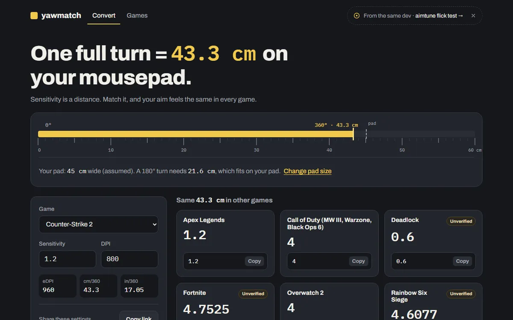

# Yaw-Match



Convert mouse sensitivity between games and keep the same physical feel.

**Live site:** https://umut-hope.github.io/Yaw-Match/

Enter your sensitivity, DPI and game. Yaw-Match shows the matching sensitivity in every
supported game, your cm/360 and eDPI, and a console/config line you can copy. Everything
runs in your browser: no accounts, no cookies, no backend. Anonymous page views are counted
with [GoatCounter](https://www.goatcounter.com/); your settings are never sent.

## Features

- Convert between games with 360° distance matching (hip-fire)
- "All games" table with copyable console/config lines
- Shareable links: `?from=cs2&sens=1.2&dpi=800`
- Your last settings are remembered in the browser (localStorage only)
- Games database with yaw values, sources and a trust label for each game
- Works on phones; light and dark theme

## How it works

Every game turns the camera by a fixed angle per mouse count:

```
degrees turned = counts × sensitivity × yaw
```

`yaw` is a per-game constant in degrees per count (for example 0.022 in CS2). From that:

```
counts per 360 = 360 / (sensitivity × yaw)
cm per 360     = counts per 360 / DPI × 2.54
eDPI           = sensitivity × DPI
```

To keep the same cm/360 in another game:

```
sens_B = sens_A × yaw_A / yaw_B
```

## Game data and trust levels

Each game lives in [`data/games/`](data/games) as one JSON file, validated by a
[Zod schema](data/schema.ts) in CI. The build also publishes the full list as one JSON array at
`https://umut-hope.github.io/Yaw-Match/data/games.json` for other tools to fetch.
Every yaw value has a source or is marked unverified:

| Label | Meaning |
|---|---|
| Official | From the developer's own documentation |
| Measured | Measured in game with a repeatable method |
| Community | Several independent sources agree |
| Unverified | No source yet, or sources disagree |

Spotted a wrong value? See [CONTRIBUTING.md](CONTRIBUTING.md).

## Development

Requires Node.js 24.

```bash
npm install
npm run dev       # http://localhost:5173/Yaw-Match/
npm test          # unit tests and game data validation
npm run check     # type checking
npm run build     # production build in dist/
```

Project layout:

```
data/
  schema.ts        Zod schema for game entries
  games/*.json     one file per game
src/
  core/            pure math, no DOM or UI imports
  ui/              Svelte components and browser helpers
```

`src/core/` stays framework-free so it can be reused outside the website.

Pushes to `main` are tested and deployed to GitHub Pages by
[a GitHub Actions workflow](.github/workflows/deploy.yml).

## License

- Code: [MIT](LICENSE)
- Game data in `data/`: [CC BY 4.0](data/LICENSE)

Not affiliated with any game publisher. Game names belong to their respective owners.
